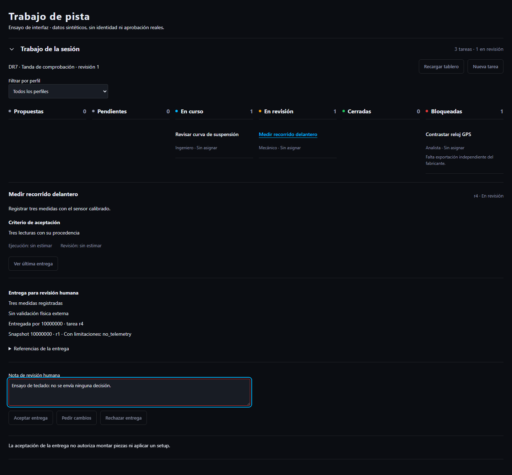
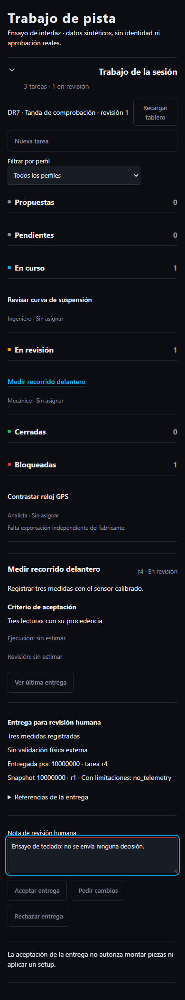

# Tablero de sesión y revisión humana

Entrega parcial del plan aprobado `2026-11-01-session-guide-workboard`.
Fecha: 2026-11-03. Sin despliegue, migraciones cloud ni decisiones humanas nuevas.

## Comportamiento implementado

Chassis incluye un tablero plegable por sesión/equipo, visible desde todos los
perfiles. Conserva el lienzo y los paneles existentes. Las columnas representan
propuestas, pendientes, en curso, en revisión, cerradas y bloqueadas. En móvil se
apilan; no se exige arrastrar tarjetas ni se produce desbordamiento horizontal.
El filtro inicial sigue la vista de trabajo y puede mostrar todos los perfiles;
no modifica permisos del usuario.

Permite crear tareas con instrucciones/criterio, asignarse o consultar un miembro
concreto, registrar bloqueos, avanzar mediante botones y entregar resultados con
un snapshot persistido. La selección puede recuperar el snapshot del análisis
actual; si no existe, informa del requisito, sin fabricar evidencia. Las
estimaciones de ejecución y revisión se muestran separadas y, si faltan, como
sin estimar. No se inventan responsables, duración ni resultados de agentes.

La revisión presenta resumen, límites, snapshot/calidad, huella y decisión
persistida. Solo muestra acciones humanas cuando la designación obtenida del
servidor incluye al usuario actual y el contenido sigue vigente. Antes de enviar
comprueba otra vez la designación; el servidor conserva la autoridad final.
Aceptar una entrega no autoriza montaje. Un cambio mecánico no puede iniciarse
desde aquí sin el flujo específico de autorización.

Se añade GET `/api/v1/engineering/workboard/tasks/{id}/latest-review`: permite
recuperar la última entrega al volver a una tarea cerrada, sin depender de una
referencia guardada en el navegador. Consulta el historial de esa tarea/equipo
con los índices existentes y valida paquete, tarea y snapshots. No hay migración.

## Robustez

Cliente autenticado sin fallback local. Descarta equipos/contratos incoherentes,
IDs ajenos y respuestas de una generación de identidad anterior. Al cambiar
usuario/equipo/sesión/revisión desmonta el estado anterior y cancela solicitudes.

Los intentos conservan operación y revisión si falla la red; tras confirmación
retiran la clave para permitir una creación nueva aunque sus campos coincidan.
Los campos quedan bloqueados mientras se guarda. Borradores, incluido un snapshot
sin texto adicional, participan en el guardado de navegación existente.
Descartar limpia realmente el formulario. Una tarea distinta elimina metadatos
de la revisión previamente seleccionada.

## Verificación y revisión

- 104 pruebas dirigidas PostgreSQL/HTTP PASS, con recuperación de la última
  entrega después del cierre y ocultación entre equipos.
- 67 pruebas dirigidas de cliente, componente, vistas y proxy PASS.
- Typecheck, lint de archivos nuevos, exportación de perímetro y build PASS.
- Dos pruebas Playwright PASS: escritorio1440 y móvil390, apertura/lectura de
  entrega, nota humana, estado de botones y ausencia de overflow horizontal.
  El fixture y sus respuestas son **sintéticos**, sin login o decisiones reales.
- Revisión independiente encontró cuatro fallos de borrador/idempotencia,
  reproducidos RED y corregidos GREEN; revisor repitió14pruebas PASS sin
  hallazgos bloqueantes restantes. El cambio de tarea también limpia revisión vieja.
- Una prueba previa de comparación usaba una etiqueta ambigua para el input y
  sus botones; ahora selecciona el spinbutton exacto. Conserva la comprobación
  de borradores A/B y no modifica la implementación visual preexistente.

Impeccable: extensión Operate del sistema existente, sin identidad visual nueva.
Tablero plegable, listas compactas, estados con texto/color, controles nativos,
foco visible y tokens reales del proyecto. Detector mecánico sin hallazgos;
inspección visual de escritorio/móvil realizada en dos pasadas acotadas.

Capturas de ensayo:

## Límites de esta aceptación

No acredita navegador con identidad real, artefactos inmutables ni producción.
El build corresponde al árbol de trabajo, que conserva cambios visuales previos
no incluidos en este commit. Vite informa de imports estáticos/dinámicos mixtos
y bundles grandes; no bloquean el build y siguen pendientes de optimización.
La prueba heredada de comparación emite un aviso act; la suite pasa.

La asignación a otro miembro requiere su referencia exacta; no se ha abierto un
directorio general de personas. Crear tareas automáticamente desde especialistas,
editar estimaciones, Cicerone persistente, informes y paquete de sesión siguen
pendientes. El tablero no sustituye esas entregas ni las presenta como activas.
Siguiente: aceptación integrada del navegador con identidad real y reconstrucción
de artefactos coordinados, además del plan de guía. Revocación histórica pendiente.
